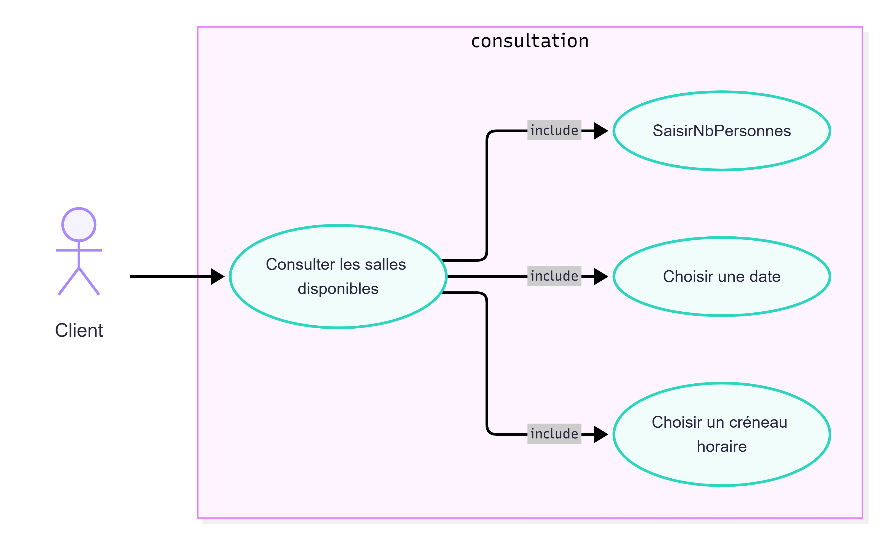
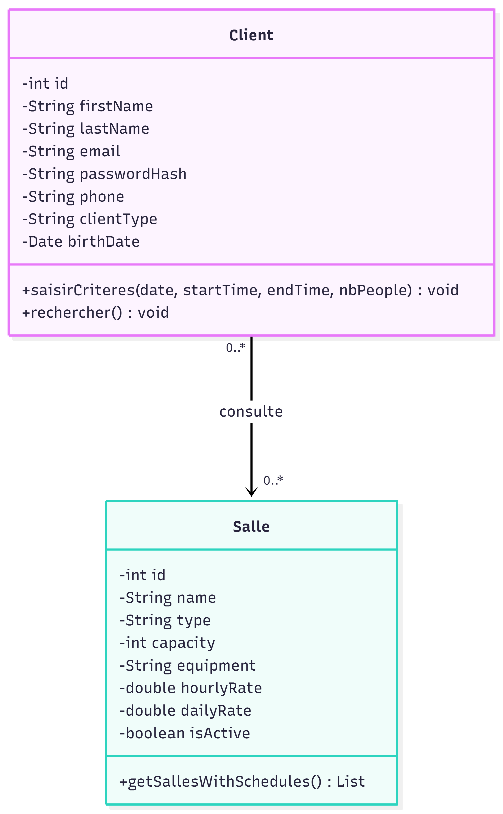
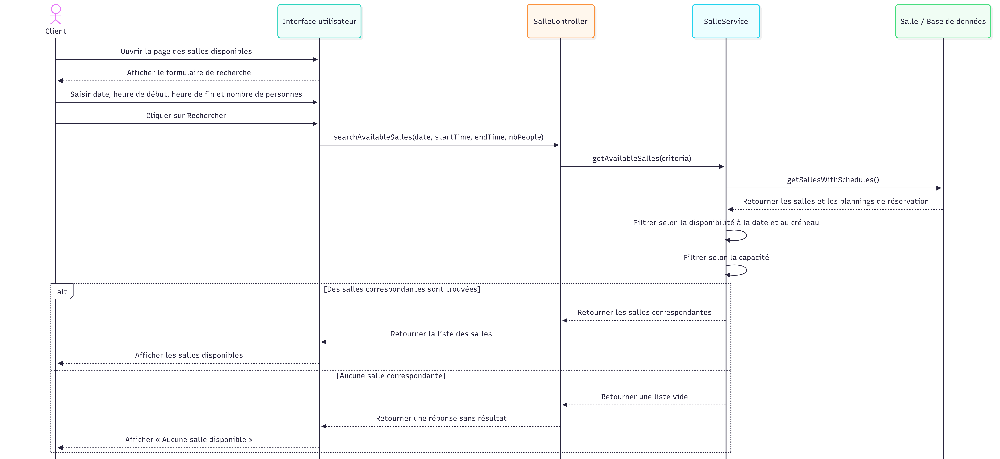

# calma-workspace

## techImp CW8 — Done

SQL schema: [`database/schema.sql`](database/schema.sql)

### Tables
- **`user`**: Core user accounts (name, email, password, phone, role).
- **`client`**: Client profile linked to `user` (client type).
- **`manager` / `tracking_agent` / `payment_agent`**: Role-specific tables linked to `user`.
- **`salle`**: Available rooms (name, type, capacity).
- **`reservation`**: Room bookings by clients (date, time slot, people count, billing mode, price, status).
- **`payment`**: Payment records tied to a reservation and client (amount, method, status, receipt).

### Relationships
- `user` → `client` / `manager` / `tracking_agent` / `payment_agent`: `1` to `0..1` role profile.
- `client` → `reservation`: `1` to `0..*` bookings.
- `salle` → `reservation`: `1` to `0..*` bookings.
- `reservation` → `payment`: `1` to `0..1` payment.
- `client` → `payment`: `1` to `0..*` payments.

---

## CW10-US2.2

### Use Case Diagram

A `Client` consults available rooms by specifying the number of people, a date, and a time slot.

### Class Diagram

Shows the `Client` and `Salle` classes, their attributes and methods (`saisirCriteres`, `rechercher`, `getSallesWithSchedules`), and the `0..*` `consulte` association.

### Sequence Diagram

Illustrates the availability search flow from `Client` and UI through `SalleController`, `SalleService`, and the database, filtering by date/time slot and capacity before returning matching rooms or an empty message.
